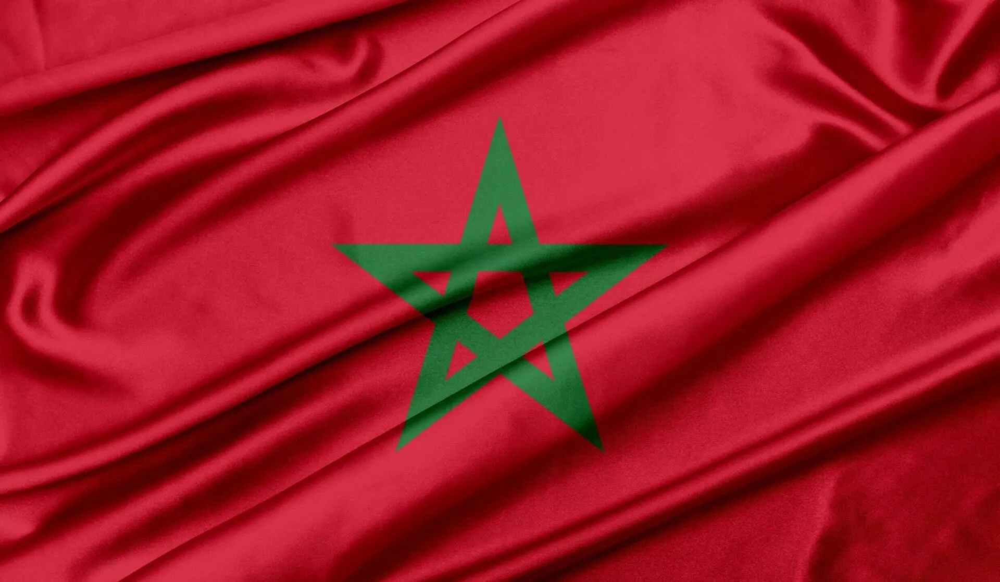
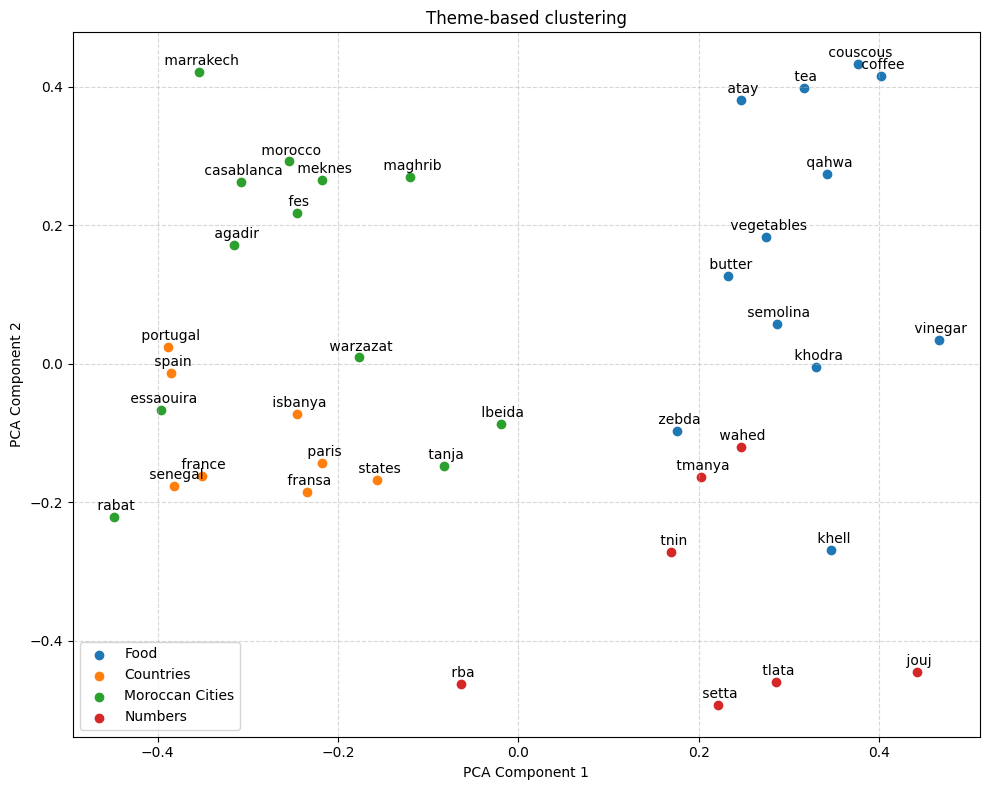
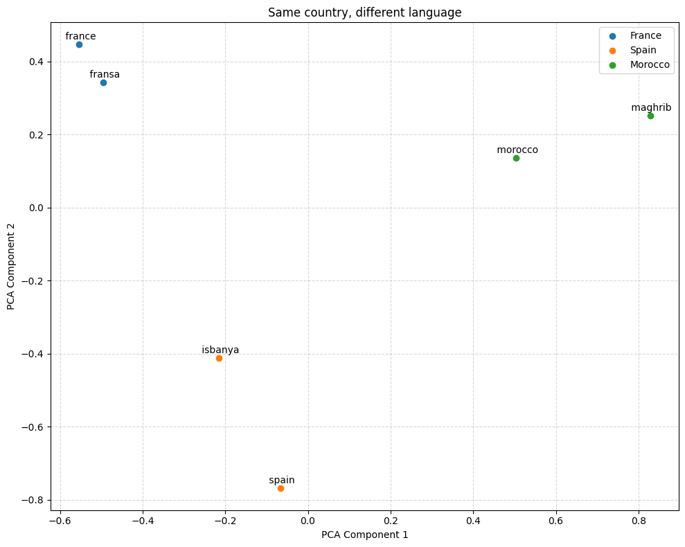

# Transformer for Translation from English to Darija (Moroccan Arabic)  

  

This project implements a Transformer-based model to translate English to Darija, with Darija written in latin alphabet.  
The project is made of 3 parts :  
- a dataset generation, leveraging Gemini 2.5 Flash's knowledge of Moroccan Arabic for 280k highly accurate sentence-pair translations, available on this Hugging Face **[page](https://huggingface.co/datasets/ilias-brh/english-darija-arabizi-sentence-pairs)**  
- a shared-language BPE tokenizer training, using BPE dropout to face the unstructured and unregulated grammar and orthograph of darija, available on HF **[here](https://huggingface.co/ilias-brh/transformer-english-darija-arabizi/tree/main/shared-tokenizer)**  
- a transformer-based translation model training, following the initial 2017 architecture, apart from pre-layer norm, weight tying and a few other details. The model is available as well on HF **[here](https://huggingface.co/ilias-brh/transformer-english-darija-arabizi)** with its corresponding tokenizer  
  
Overall, the model training took 4.5 hours on a A100 GPU. **Further interesting details are in the project recap, in [English](./english_project_recap.pdf) or in [French](./french_project_recap.pdf).** The English version is a translation by an LLM from the French version so I apologize if it sounds LLMish.

# Testing the Model online

The model can be tested online on **[this HF Space](https://huggingface.co/spaces/ilias-brh/translation-english-darija)**. To test it for the potential non-Darija speakers checking this project, I recommend writing in your English sentence, then copying the translation to an LLM and asking it to translate back to English (to see if it matches the initial request) and, on the way, asking the LLM to rate the translation out of ten based on how native and natural the sentence feels. Long sentences (around 80 words) might take up to a minute to be translated on the HF Space. 

# Project structure  

The `tokenizers` folder contains the tokenizers used for the model, the final one being the shared tokenizer.  
The `src` folder contains the model training Python files, including the training loop in `model.py` and the model's structure in `utils/modules.py`.  
The `slurmlogs` folder contains the Slurm logs during the last training made in June 2026, to see the loss convergence, and some inference tests to assess the model's level.  
The `darija_dataset` folder contains the prompt and themes given to Gemini 2.5 Flash to generate the 280K sentences dataset.  
The `datasets` folder contains the Python files used to regularize the dataset, then to tokenize it and finally to convert it to tensors including padding tokens.   

# Embedding space visualization  

After successfully training the 97M model, it's interesting to look at some PCA reductions of the embedding space, to visualize for example theme-based clustering (left image) as well as the clustering for same word different language (right image) since a shared embedding layer is used for the encoder and the decoder.  
  
|  |  |
| :--- | :--- |

# Translation examples  

| English Source | Translation Model Output (Darija) |
| :--- | :--- |
| Can you show me the way to the old medina? I’m completely lost and my phone’s battery is dead. | wach t9der twerini tri9 l lmedina l9dima? ana telft kaml w tele dyali ma b9ach fih la batterie. |
| I spent nearly forty-five minutes this morning arguing with the merchant at the weekly souk over the price of fresh mint and orange blossom water needed for the family gathering, entirely forgetting that my grandmother expected me back hours ago to help roll the semolina grains for the Friday couscous, which meant I had to hurriedly catch a shared grand taxi under the blazing midday heat just to avoid her legendary disapproval. | dwezzt chi khamsa w arba3in dqiqa had sba7 wana kan3awd m3a lbiya3 f souq l’ousbou3i 3la taman dyal na3na3 jdid w ma zhar li khasso l jam3a dyal la famille, nssit ga3 belli jaddati kant katssennani men qbel swaye3 bach n3awen ndawwer 7boub smida l couscous dyal nhar ljomu3, dakchi li khasni khassni nchadd taxi kbir mouchtarak ta7t skhouna dyal nos nhar ghir bach netfadda rafdha l’os6ori. |  

# Contribution to open-source  

The dataset that I made Gemini generate was made available for **[AtlasIA](https://huggingface.co/atlasia)**, the AI community driving innovation for Morocco. This distillation from Gemini 2.5 Flash's multi-lingual knowledge indeed gave impressing results, as most sentence-pair datasets until then were made from unregularized social media content translation, which did not give rich vocabulary, and contained abreviations, slang, typos, and sometimes a mix of languages.  
